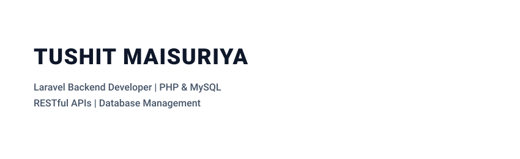

# Hi, I'm Tushit Maisuriya 👋 👨‍💻

<!-- Animated Typing Headline -->

  

<!-- Profile Hero Card (Monica Powell Reference Layout) -->

  

 

I am a backend developer specializing in architecting robust web applications with PHP, Laravel, and MySQL[cite: 1]. My focus centers on clean MVC design, Eloquent ORM performance, scalable relational database structures, and production-ready business logic[cite: 1]. With hands-on experience handling live server deployments via cPanel, routine backups, and active debugging, I turn complex business requirements into stable digital workflows[cite: 1]. Alongside strong backend fundamentals, I utilize Tailwind CSS, JavaScript, and Git to maintain clean code and collaborative development cycles[cite: 1]. Always keen to tackle complex engineering challenges and build reliable, scalable web software[cite: 1].

  <!-- Email Badge -->
  
  <!-- LinkedIn Badge (Add your direct profile slug here) -->
  
  <!-- Phone / WhatsApp Badge -->
  

---

### 🐍 Contribution Activity

  

---

### 📌 Highlighted Projects

* **CodePilot**  
  An interactive online developer training platform featuring integrated tutorials and an in-browser debugger that eliminates local setup requirements for learners[cite: 1].  
  `Stack: Laravel, Tailwind CSS, Ajax, JavaScript`[cite: 1]

* **Krishna Catering Web Application**  
  A complete commercial web platform featuring complex calculation-based backend logic, MySQL management, and live cPanel production deployments[cite: 1].  
  `Stack: Laravel, MySQL, cPanel`[cite: 1]

---

### 🛠️ Tech Stack & Skills

  

---

  
  

 

  Engineered with precision by Tushit Maisuriya

